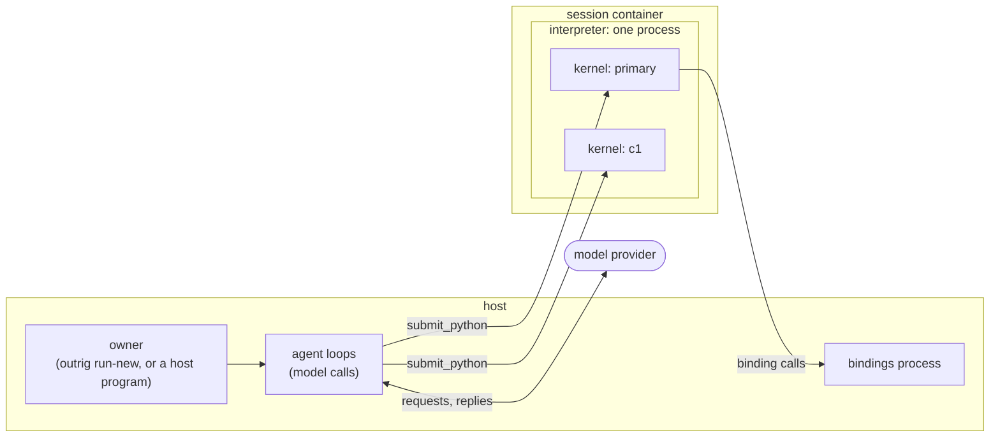

# Python Runtime

> Preview. This page describes the agents of `outrig run-new` and of the sessions a
> [host program](../usage/host-programs.md) owns, which act by writing Python. `outrig run` and
> `outrig run-legacy` start the other system, an agent that calls the tools of MCP servers (see
> [MCP Servers](mcp-servers.md)). A later release makes `outrig run` this one.

In a `run-new` session the model has one tool, `submit_python`. It sends Python source to an
interpreter inside the session's container and reads back what the code printed and how it
ended. Everything the agent does is Python it writes: it reads and edits files with `pathlib`,
runs commands with `subprocess`, receives and answers your messages, launches other agents, and
calls objects that programs on the host hold for it. The interpreter is OutRig's own static
CPython, mounted read-only at `/outrig/python`, so the image needs no Python of its own.
[Reference -> CLI](../reference/cli.md#outrig-run-new) describes the interactive session -- what
you type, what is printed, how it ends; this page describes what the agent's Python is.



## Vocabulary

The two systems use one word differently, so the words are fixed here, and every page that uses
them says which system it describes.

- A **round** is one prompt or message, the agent working on it, and the agent giving control
  back. In `outrig run`, the same thing is called a turn.
- A **turn** is one model call and the tool calls it asked for, with their results; in
  `run-new`, the Python it submitted. A round contains turns.
- An **execution** is one submission: a piece of Python run in an agent's kernel, with one
  result.
- The **interpreter** is the process: one per session, inside its container, holding every
  agent's kernel and one memory ceiling.
- A **kernel** is one agent's environment inside the interpreter: its names, its event loop, its
  channels, and the slot its executions run in, one at a time. Kernels are threads of the
  interpreter, not processes.
- The **owner** is the program holding the session: `outrig run-new`, a Rust program that embeds
  OutRig, or the engine acting for a host program.
- A **binding** is an object a process on the host holds for the agents, reached under a name.
  [Hosted Objects](hosted-objects.md) describes them.
- A **facility** is an object an agent is given to act through: a binding, or a plain Python
  object. An agent class's constructor takes them in its `facilities=` dict; see
  [Facilities](#facilities).

## Executions

Each submission is one execution: the source runs in the agent's kernel, compiled as `<execution>`,
with top-level `await` allowed. The model reads back what the code printed, the `repr` of a trailing
expression, and a traceback if one was raised, along with what code still running from earlier
executions has printed since. What it reads is bounded: an execution's own output is cut to 16 KiB,
the earlier executions' to its last 2 KiB, an echoed value to 1,000 characters, and the whole result
to [`tool-result-max`](../reference/config.md#top-level). `help(x)` is cut at 8 KiB, and
`runtime.names()` lists what the agent has bound with each value's type, without calling `repr()` or
anything else the agent wrote.

An execution ends one of three ways:

- `ok` -- the code ran to its end.
- `error` -- it raised, or did not compile.
- `unknown` -- no result arrived: the interpreter exited, or the caller stopped waiting for it,
  as a second Ctrl-C does. What the code did may or may not have happened.

Nothing is rolled back, and a lost result is never retried automatically: an execution with an
`unknown` result may have written the file or sent the request it was about. A kernel runs one
execution at a time, and a second submission while one runs is refused, naming the one that
holds the kernel.

Two protections apply to every execution. Code that keeps its event loop from turning while a
CPU stays busy, such as `while True: pass`, is interrupted after about half a minute, and the
model reads the traceback; code waiting on a subprocess, a sleep, or a read is left to finish.
And the interpreter lowers its own memory ceiling to half of what the container can see, so code
that allocates past it gets a `MemoryError` the model reads, not a killed process. The ceiling is
the whole interpreter's, every agent's together, and each program the code starts inherits it.

## Rounds

A round opens when something waits for the agent -- in `outrig run-new`, a message you sent --
and ends when the model gives control back: it replies without calling its tool, or a limit stops
it, such as [`tool-call-max`](../reference/config.md#top-level) tool calls in the round. A round
that ends does not mean the work did. Tasks the agent's code started keep running after the round
ends, and `outrig run-new` closes the round with a line that names them,
`(still running: ci_run)`.

Waiting costs no model calls. An execution that waits ten minutes on a build makes no model call
while it waits: the model is called again only once the execution returns. So a round can last
as long as the work does.

Each model call is sent part of the conversation: the session's first two rounds, the six before
the current one, and the current one, held to the model's context window. The agent's Python
holds all of it, turn by turn, in `runtime.history.turns`, where reading it costs no context.
`runtime.context.promote(turn)` sends a turn again, in its place, until
`runtime.context.demote(turn)`. [Reference -> CLI](../reference/cli.md#outrig-run-new) gives the
rules for what is left out when a call does not fit.

## Names persist

The names an execution binds stay bound in the agent's kernel for every later execution and
round: a parsed file, an open connection, a task still running. The conversation is not the only
thing that carries state from one message to the next; the agent's variables do.

They are the kernel's: a child agent starts with none of its parent's names. And they last as
long as the interpreter. If it exits -- Python that calls `os._exit`, say -- the
session ends, and no later session restores them.

## Channels, and waiting

You reach the agent through a channel, not through its prompt. In `outrig run-new`, each line you
type is a message on the agent's `user` channel, `runtime.channels["user"]`. The model is told
how many messages wait there, never what they say. Its code reads one with
`await runtime.channels["user"].receive()`, which returns a `Delivery` whose `body` is the
message, and answers with `await runtime.channels["user"].send(text)`. Only what the agent sends
on the channel is printed for you; the model's own text is commentary.

`await runtime.wait(fs, timeout=None, return_when=asyncio.ALL_COMPLETED)` is Python's
`asyncio.wait` that also watches the agent's channels. It returns `(done, pending)` when
`return_when` is met or the timeout passes; a timeout cancels nothing. While a message waits
unread on any of the agent's channels, it raises `runtime.MessageAvailable` instead, and leaves
the message queued and the operations running. So a message typed while the agent's code waits
ends the wait and not the work: the model reads the message in the same round, decides what to
do, and can wait on the same tasks again.

A bare `await` does not watch channels. A message sent while code awaits directly waits until
that code finishes, and Ctrl-C is how to stop it sooner. That is why the agent is told to run
long work as a task, `asyncio.create_task(build(), name="build")`, and wait on it with
`runtime.wait` and a `timeout=`. A call to a binding holds the kernel's event loop in the same
way until the host answers; see [Hosted Objects](hosted-objects.md#a-call-blocks-its-caller).

## Child agents

An agent's code can launch other agents. Each child is a kernel of its own in the same
interpreter, with its own names, conversation and model calls, and the bindings its parent
sees: the session's, unless an agent above it was given [facilities](#facilities). Its id is
`c1`, `c2`, and so on in launch order, and its events carry the subject `agent/c1`. A child has
no user channel: only the code that launched it gives it work, and what it writes reaches you
only through that code.

### Spawning a child

`await runtime.spawn(name, prompt=..., model=None, inputs=None, requests=None)` launches one and
returns its `Child`. `prompt` is the first part of the child's instructions; `model` names a
configured model or alias, else the child runs on its parent's; `inputs`, a dict, is bound in the
child's namespace as variables. Inputs must be data -- `None`, str, int, bool, float, lists and
str-keyed dicts of these, or dataclass instances -- and the child gets a copy. An object a binding
holds cannot be an input: the child reaches the bindings it sees by name, and an agent class takes
one in its constructor's `facilities=` dict.

There are two kinds of child:

- A **work child** takes submissions. `child.submit(inputs, result=T)` gives it one, and the child
  answers with `await runtime.complete(value)`, a value of type `T`, or ends it unanswered with
  `await runtime.fail(message)`. It works on one submission at a time; later ones queue.
- A **request child** answers requests on named channels. Launched with
  `requests={"review": outrig.Request(Diff, Verdict, doc="...")}`, it is sent one with
  `child.channels["review"].request(diff)`; its code takes it with
  `d = await runtime.channels["review"].receive()` and answers with `await d.reply(verdict)`, or
  ends it with `await d.fail(message)`.

Each submission and request returns a handle at once, the work already sent. `await handle`
gives the answer, an instance of the declared type, or raises an `outrig.AgentError` saying why
there is none:

- `CompletionRejected` -- the answers failed their check past the attempt limit.
- `AgentRequestFailed` -- the child ended the work with `fail(message)`.
- `RequestCancelled` -- the sender cancelled it with `handle.cancel()`, or the engine did, as
  below.
- `AgentReleased` -- the child, or an agent above it, was released first.
- `AgentLimitReached` -- a limit refused the work at once (see [Limits](#limits)).
- `BudgetExhausted` -- the session's `token-budget` was spent.
- `SessionClosing` -- the session closed to new work.

A typed call and an agent class's request (both below) can also fail on the caller's side, and
their handles then raise what is not an `outrig.AgentError`: a typed call whose `validate=`
function raised raises that exception, and a model that is not configured, or work too long to
send, raises `ValueError`. `except outrig.AgentError` lets those through.

`handle.done()`, `handle.result()` and `handle.status` read it without waiting, and
`runtime.wait` takes handles, so an agent can wait for whichever of a build and a review finishes
first. Cancelling the code that awaits a handle cancels the wait, never the work;
`handle.cancel()` cancels the work.

### Completion and repair

An answer is decoded strictly into its declared type, which is declared with `outrig.schema`: an
unknown key, a missing field, or `null` where the type has no `None` is a problem, reported with
its JSON path. A `validate=` function, where the work declares one, checks the decoded answer as
well. An answer with problems raises in the child, at its `complete` or `reply`, listing each
problem, and counts one attempt; the child corrects the answer and sends it again, without running
the work that produced it again. Past the attempt limit, three by default, the work ends
`CompletionRejected`, carrying the last answer and its problems.

### A request is worked on or cancelled

The engine opens a child's rounds; nothing else does. When a round ends, it compares what the
child holds -- requests waiting unread, and those it took and has not answered -- with what the
round opened on:

- Nothing held: the child is idle. This is the only way a child becomes idle.
- Something changed -- a reply, a `fail`, a receive, a new arrival, a cancel: another round opens
  on what is held now. Its opening names each request the child took and has not answered.
- Nothing changed, the first time: a warning round. It names what is outstanding, says that ending
  a round is not waiting, and gives the ways out: answer, `fail(message)`, or `runtime.wait`.
- Nothing changed after the warning: the engine cancels every request the child holds. Each
  sender's handle raises `RequestCancelled`, saying the child ended its rounds without answering
  it, and `agent.request.cancelled` records the engine's `reason`.

So a request sent to a child is either being worked on or cancelled, and its sender is told which.
A child's closing text is never delivered to the sender: only `reply`, `complete` and `fail`
answer.

### Releasing a child

`await runtime.release([child])` releases children, all of a list or none of it. A release ends
what the child holds: its open requests end `AgentReleased`, its own children are released the
same way, its tasks are cancelled and its kernel is removed. A child whose code never yields cannot
be stopped; it is reported `wedged` and stays, holding its place under `children-max`, until the
session ends.

### What a child spends

A child's model calls are its own, recorded under its subject, and they are added to the agent
that launched it. Each round's events carry `descendants`, the attempts and tokens of the children
the round launched, and `total`, the round's own with theirs; what a child spends after its
parent's round ended is published as `model.round.usage`. A call of an `@outrig.agent` function
records its child's whole spend on `agent.call.settled`, and a skill invocation records the
spend of every child made inside it on `skill.invocation.finished`. The
[event log](../reference/events.md) lists the fields.

### Limits

Five settings bound a session's agents, each at the top level of the configuration or under
`[agents.<name>]` (see [Config -> Top level](../reference/config.md#top-level)):

- `children-max` (default 64) -- children resident at once: launching, working, idle, or wedged.
  A launch past it raises `AgentLimitReached` at once rather than waiting.
- `model-concurrency-max` (default 8) -- model requests in flight across the session, every
  agent's together. A request past it waits its turn; a parent waiting on a child holds none.
- `requests-max` (default 256) -- requests one child holds unsettled. A `submit()` or `request()`
  past it raises `AgentLimitReached` at once.
- `token-budget` (unset by default) -- tokens every model call of the session spends in all, the
  main agent's included. Once spent, no model call is made, and open work ends `BudgetExhausted`.
- `subagent-depth-max` (default 3) -- how deep agents nest. The main agent is at depth 1, and an
  agent at the limit cannot spawn.

None of them bounds the CPU or memory a child's code uses once it is running. `outrig run`'s
`subagent-width-max` does not apply here: it bounds `run`'s subagents, a different system (see
[Subagents](subagents.md)).

## Typed agent work: `@outrig.agent`

`@outrig.agent` declares an `async def` as work for a child agent. Its parameters are the inputs,
its docstring the child's instructions, and its return annotation the type of the result:

```python
import asyncio
from dataclasses import dataclass
import outrig

@dataclass
class Finding:
    file: str
    problem: str

@outrig.agent
async def review(path: str) -> list[Finding]:
    """Review the file at `path` for error handling that loses the error."""

findings = await asyncio.gather(*(review(p) for p in ["src/a.py", "src/b.py"]))
```

The body is never run. Each call checks its arguments, launches a fresh work child, gives it the
arguments as its submission, and returns the handle at once; awaiting it gives the result,
decoded and checked as above. The child is released once the call settles, awaited or not.
`asyncio.gather` over calls runs them in parallel, within the session's limits.
`@outrig.agent(validate=check, model="fast")` adds a validator, called with the decoded result
and the arguments, and names the child's model. A declaration missing a docstring or an
annotation raises `TypeError` when it is made, naming it.

## Agent classes: `outrig.Agent`

A subclass of `outrig.Agent` declares a long-lived child instead. Its docstring is the child's
instructions, and each `async def` it marks `@outrig.agent` is a request channel of that name,
whose parameters make the request and whose return annotation is the reply's type:

```python
class Reviewer(outrig.Agent):
    """You review changes to the repository in your working directory."""

    @outrig.agent
    async def review(self, path: str) -> list[Finding]:
        """Review the file at `path`."""

async with Reviewer() as reviewer:
    first = await reviewer.review("src/a.py")
    second = await reviewer.review("src/b.py")
```

Constructing one returns at once and launches its child in the background, whose first round is
for getting ready; `await reviewer.ready()` waits for it, and `async with` waits on entry. A call
of a marked method sends a request and returns its handle. The child keeps its names and its
conversation from one request to the next, so the second review can use what the first one read.
`await reviewer.release()`, or leaving `async with`, ends it; an instance collected while
unreleased is released then. A host program declares and drives agent classes the same way, its
replies decoded into its own classes: see
[Host programs -> Agent classes](../usage/host-programs.md#agent-classes).

### Facilities

An agent class's constructor takes, beside its data, a dict of the objects its child acts through:

```python
reviewer = Reviewer(facilities={"files": repo})
```

The instance keeps a copy as `reviewer.facilities`, and the child's view follows that mapping. Its
instructions list each entry by name and kind; each is a global of its name where the name is
free; `outrig.bindings[name]` reaches each; and `runtime.bindings` lists the mapping as it stands,
read anew each time. No other binding is listed or reached by name: `outrig.bindings["repo"]`
raises `KeyError` in the child above, though the session binds `repo`. A name follows an input's
rules, and is not `outrig`, `self`, an input's name or a class bound in the child.

- **A binding** -- its global, or `outrig.facility(name)` -- becomes a reference to that binding,
  `outrig.Facility`, which resolves in each kernel to that kernel's own proxy. So a child's calls
  go over its own connections and its `hosted.*` events name it, and a reference passed on
  through several constructors is one binding with a caller at each level.
- **A plain object** is the object itself, shared by the agents given it. A call on it is
  ordinary Python in the calling agent: it crosses nothing, and is not evented.
- **Refused**, naming the entry: a proxy of an object a binding returned (`repo.index`, say),
  which belongs to one agent's connection -- give the binding, or a narrower binding of its own;
  and a coroutine or generator, which one agent can consume once.

A child made without `facilities=` -- by `runtime.spawn`, a typed call, or a constructor given
none -- sees what its parent sees: a copy of its parent's mapping as it stands at the launch, or,
under the main agent, every binding. A child given `{}` sees none. The mapping is the agent's to
change; an entry added later is listed and reached through `outrig.bindings[name]`, but is no
global, and its instructions, composed once, are not redone. The view is what an agent is told,
not what it may do: agents in one session are not isolated from each other, and every kernel can
reach every binding, as
[`SECURITY.md`](https://github.com/tgockel/outrig/blob/trunk/SECURITY.md) says under "Known
boundaries". A host program cannot give facilities yet; its
`facilities=` raises `NotImplementedError`.

## Skills

A skill is a directory holding a `SKILL.md` -- a name and description in its frontmatter, then
instructions -- and, optionally, a `skill.py`. A `run-new` session serves the skills of two
directories, in order: the repository's `.agents/skills`, then `~/.agents/skills`. The first that
holds a name serves it; a later copy is reported as shadowed as the session starts, as is each
skill left out and why. A host program's session serves none.

The main agent is told each skill's name and description, up to 50 of them or 12 KiB; a child is
told none. Its code reads a skill's instructions with `outrig.skills.read(name)`, lists every
skill with `outrig.skills.catalog()`, and imports a skill's code as the package
`outrig_skills.<name>`. A skill's files are read from the host as the code imports or opens them:
nothing is mounted for them, and a skill's own modules shadow nothing on `sys.path`. Importing
one checks the `requires-python` and `dependencies` its `skill.py` declares and installs nothing.

A line `/name text` you type reaches the agent as a directive naming the skill, which asks it to
run it, and the agent's code does so with `outrig.skills.invoke`:

- `outrig.skills.invoke(name, text)` reads `text` into the skill's parameters with a typed agent
  call on the calling agent's model, then calls the skill's entry function, `main` unless the
  skill names another. The parameter class, `outrig.skills.params(name)`, is derived from the
  entry's signature, one field per parameter. The child that reads the text may find it does not
  say what the entry needs: awaiting then raises `SkillNeedsClarification`, whose `question` the
  agent puts to you, and nothing is called.
- `outrig.skills.invoke(name, params=...)` takes an instance of that class and asks no model.

Either way the invocation is a handle to await, and a parameter the skill binds to one of the
session's bindings gets that binding. `skill.invocation.started` records the parameters and where
they came from: `by` is `parser`, with the typed call that read them, or `caller`.
`skill.invocation.finished` records how the entry ended and the spend of every child made inside
the invocation -- its parser, the typed calls its code made, and every agent below them -- which
the totals of the round the invocation ran in count as well. A skill grants nothing: its code runs
with the authority of the agent that invokes it, which is why a repository's skills need no
approval and a repository's bindings do.

## Application code

A session's owner -- a Rust program embedding OutRig, through `SessionBuilder::application`, or a
host program, through `outrig.Session(application=outrig.Application(...))` -- may give it
application code: the package its agent classes are in, and what they import. It is a directory
whose top-level entries are packages and modules, as a project's `src/` is, or, from Rust, the
bytes of a tar of one.

As the session starts, OutRig reads the code on the host, with no Python run and no link followed,
skipping names that begin `.` and `__pycache__`. A compiled extension module (`.so`, `.pyd`) in it
fails the start before anything is copied, since the interpreter loads no compiled code. The rest
is copied whole to a directory named for the digest of its files' paths and contents, which the
container mounts read-only at `/outrig/app/<digest>`. Every kernel imports from that snapshot, so
an edit made to the original while the session runs changes nothing until the next session, and
the digest says which code the session ran. The interpreter puts it on `sys.path` after OutRig's
own package and before the workspace, so no file in the workspace takes the place of one of its
modules. Its `requires`, written as a binding's are, is installed as a binding's is, pure-Python
wheels only, and placed beside it. Neither the agent nor its `pip` installs anything of it.

The modules the owner names are imported as the session starts, before any kernel opens, on a
thread of the interpreter's own, outside every execution: what they print goes to the session's
`output.unattributed`. One that raises, is nowhere to import from, reaches compiled code, or takes
more than 30 seconds to import fails the start, naming the module and ending with the end of its
traceback, and no model is called. `application.provisioned` and `application.imported` record
each step (see [Events](../reference/events.md)). A module the owner does not name imports when
something first imports it.

## See also

- [Reference -> CLI](../reference/cli.md#outrig-run-new) -- `outrig run-new`'s interactive
  session: what you type, what is printed, how it ends.
- [Hosted Objects](hosted-objects.md) -- objects on the host the agents' Python uses.
- [Host programs](../usage/host-programs.md) -- a Python program on the host that owns sessions.
- [Python API](../reference/python.md) -- the `outrig` package a host program imports.
- [Event Log](../reference/events.md) -- what a session records.
